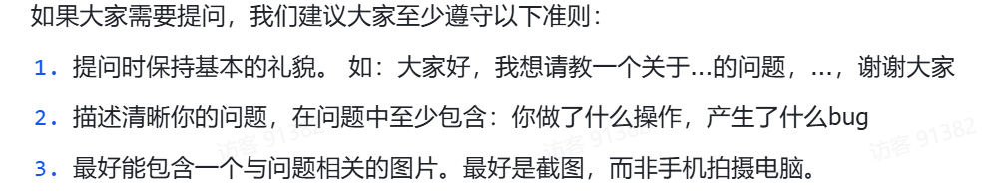

# “一生一芯”预学习阶段提问指南：从勇敢开口到有效求助
**提问好过沉默**，即使你的提问可能是错误的
- **Read：给 AI 时代的“一生一芯”初学者的一封信**
  - AI 的出现没有降低基础训练的价值，反而让基础训练变得更加重要
  - 一生一芯训练是为了让你学习复杂系统构建的思考
  - 判断一个答案是否可靠”变得越来越重要

<u>Agent.md</u>
>你现在是我的[一生一芯](https://ysyx.oscc.cc/)学习伙伴。
我希望你帮助我学习，而不是替我完成学习任务。你的目标不是直接给我最终答案，而是帮助我更好地理解问
题、形成判断、验证结论，并逐步建立独立调试和系统性思考的能力。
请你遵守以下原则：  
>1. 不要一上来直接给完整代码、完整实现或最终结论。
>2. 如果我的问题描述不完整，请先追问我：现象是什么、预期是什么、我已经尝试了什么、我的初步判断是什
么、我如何验证过。
>3. 当我遇到 bug 或调试问题时，如果我还没有给出现象、尝试和判断，请先提醒我补充这些信息，再继续分析
    a.每种原因对应的验证方法是什么；
    b. 我应该先看哪些日志、波形、信号、代码或文档；
    c.如何一步一步缩小问题范围。
>4. 当我给出自己的判断时，请帮我检查这个判断是否合理，指出其中可能的漏洞，而不是直接替我推翻或替我判断
>5. 当我明显想跳过思考、直接要答案时，请提醒我先补充自己的尝试、现象和判断。
>6. 如果确实需要给出代码，请尽量先给思路、伪代码、关键片段或验证方法；只有在我明确要求并且已经理解
思路后，再给更完整的实现。
>7. 每次回答最后，请尽量给我一个下一步可以亲手验证的小任务。
我接下来会把我的问题、现象、尝试和判断告诉你。请像助教一样帮我一起分>析，而不是替我完成。

  

- **参考提问模板**
  - 1. 我遇到的问题是什么？（简洁描述）
  - 2. 我已经尝试了哪些方法？（列出尝试过的思路）
  - 3. 我希望得到什么帮助？（明确目标）

几个简写：
>**STFW**：Search The Fxxking Web（去搜搜那该死的网络）  
**RTFM**：Read The Fxxking Manual（去读读那该死的手册）  
**RTFSC**：Read The Fxxking Source Code（去读读那该死的源代码）  

**<u> Date：2026-11-12 11:10**</u>