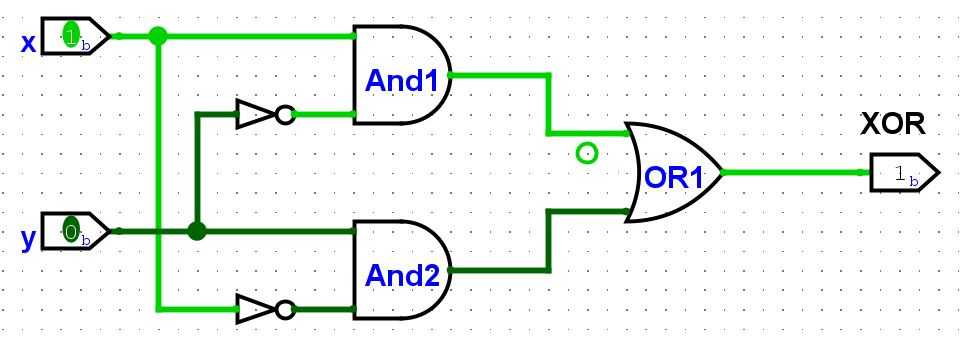
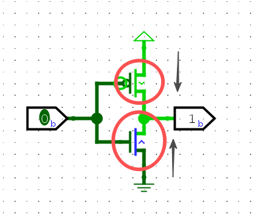

# Logism安装和使用
~~安装按照教程来即可，按照下载包。。。~~
Logisim是一个Java程序

**手册阅读**：按照手册完成一个逻辑电路的搭建test1(门电路+导线连接)

## logism 使用
- 设计第一个电路：test1
  
**异或门XOR**： $ Output = x\bar{y}+\bar{x}y$
| x | y | x XOR y |
| :---: | :---: | :---: |
| 0 | 0 | 0 |
| 0 | 1 | 1 |
| 1 | 0 | 1 |
| 1 | 1 | 0 |

  

## logism规则(在F3中遇到的一些问题)

- 蓝线：表示线路没有有效驱动源，处于悬空、高阻状态(没信号)
- 红线：表示逻辑错误，例如两个输出端同时驱动同一根导线
- 黑线：代表多位数据总线
- 绿线：逻辑0或1 

**Ub：Undefined / Floating 未定义或者悬空**
**Eb：Error 逻辑错误**

NMOS和PMOS是有方向箭头的：

  

**PMOS需要把VDD**
**NMOS需要把GND**