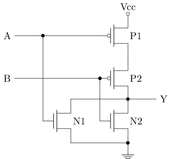
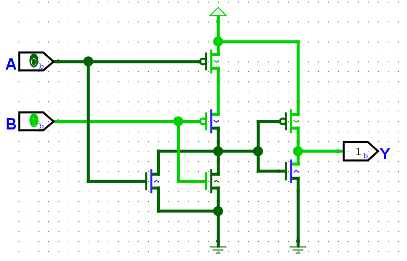
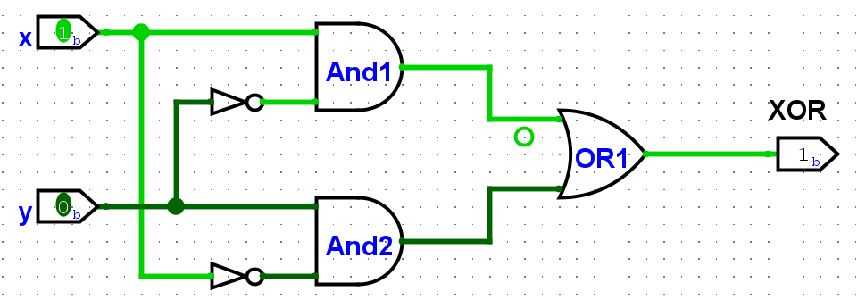
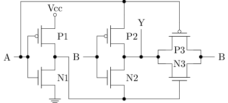

# 晶体管搭建门电路
## NOR门

  

这个门电路显然是 $Y = \overline{A+B}$, 真值表如下(**或非门NOR**)：  ~|

|A|B|Y|
|:---:|:---:|:---:|
|0|0|1|
|0|1|0|
|1|0|0|
|1|1|0|

**只有两个P管都打开，两个N管都关闭的时候，Y才输出高电平1**

>一般的：上拉网络（接 Vcc 的 PMOS）和下拉网络（接地 GND 的 NMOS）是对偶的
PMOS 导通时，可以无损耗地把 Vcc 传递给输出端，输出完美的“强 1”。
NMOS导通时，可以无损耗地把 GND 传递给输出端，输出完美的“强 0

## OR门(画出晶体管结构)XOR加一个非门
$Y =A+B$  OR A|B
|A|B|Y|
|:---:|:---:|:---:|
|0|0|0|
|0|1|1|
|1|0|1|
|1|1|1|

  

## 三输入NAND门

## 异或门 XOR 
根据在F2中的test1中完成的XOR：需要2个非门，2个与门，一个或门
>一个或门 6个晶体管
一个与门6个晶体管
一个非门 2个晶体管

按照这个方式，一共是**28个晶体管**

有没有简单的方法呢？
- **定制电路**：A=1的时候，$Y=\bar{B}$ 非门
A=0的时候，$Y=B$；传输门

所以这个时候把A当作B的输入前提，可以得到晶体管电路为：

  

一共仅需6个晶体管

## 同或门
